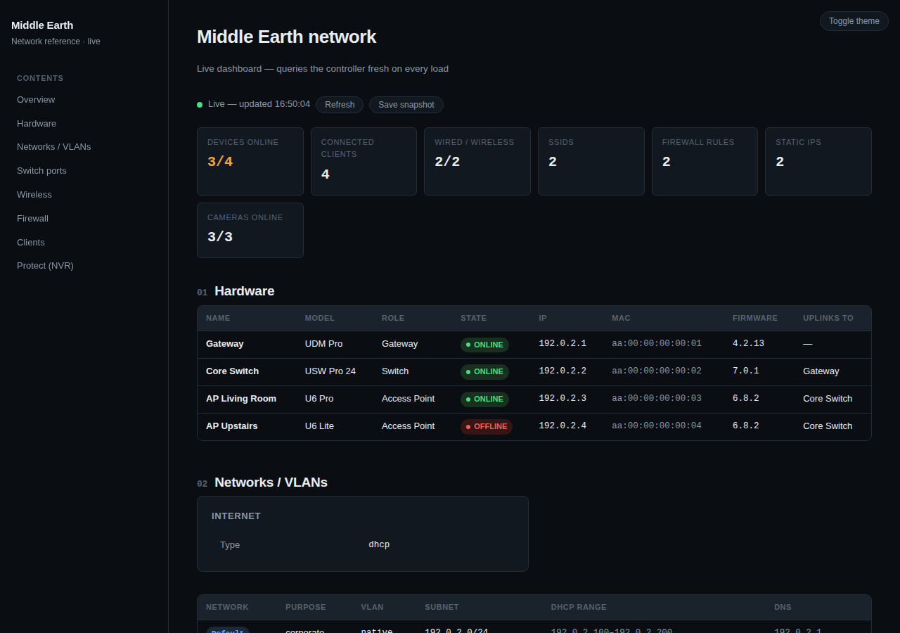

# udmp-monitor

[](https://github.com/modem7/udmp-monitor/actions/workflows/ci.yml)
[](https://github.com/modem7/udmp-monitor/commits/master)
[](https://claude.com/claude-code)

> **Vibe-coded.** This was built almost entirely by prompting Claude —
> it hasn't been carefully hand-reviewed line by line. It works for my
> setup; read the code before trusting it with yours.

Read-only tooling for querying a UniFi Dream Machine Pro over its local
UniFi OS Network Integration API (`/proxy/network/integration/v1`).

This is not a general-purpose CLI for humans to run interactively — it's
built for Claude to invoke directly (via `python3 udmp.py <command>`) to
answer diagnostic questions about the network on request. Output is JSON
on stdout for reliable machine parsing rather than human-formatted tables.
See `CLAUDE.md` for the operating rules.



*Screenshot of the live dashboard (see below) with entirely made-up
sample data — no real network details.*

## Setup

This uses two separate credentials against two separate APIs — set up
whichever commands you need.

1. **Official Integration API** (`sites`/`devices`/`clients`/`radios`):
   on the UDMP, **Settings > Control Plane > Integrations**, enable the
   Network API, and generate an API key (`UDMP_API_KEY`).

2. **Legacy session API** (`wlans`/`firewall`): the Integration API
   doesn't expose WLAN/SSID config or firewall policies at all (confirmed
   by probing the controller, not assumed). These commands fall back to
   UniFi's older, undocumented session-cookie API instead, which needs a
   **dedicated local admin account** — not your personal login. Create one
   under **Settings > Admins** with the most restrictive role that still
   has Network-app read access, and set `UDMP_UI_USERNAME`/
   `UDMP_UI_PASSWORD` for it. This API can change or break without notice
   on a firmware update, unlike the versioned Integration API.

3. **UniFi Protect Integration API** (`protect-status`, optional): only
   needed if you have a Protect NVR and want camera/chime/NVR status.
   Separate host and API key from the Network side — the NVR is often a
   standalone appliance, not the same console as the gateway. Generate a
   key in the Protect app's own integrations settings and set
   `UDMP_PROTECT_HOST`/`UDMP_PROTECT_API_KEY`. Official, versioned API
   (confirmed via `/meta/info`), same trust level as the Integration API —
   no undocumented-API caveat here.

4. Install dependencies into a virtual environment (recommended):
   ```bash
   python3 -m venv .venv
   .venv/bin/pip install -r requirements.txt
   ```
   Then run commands with `.venv/bin/python3` (e.g.
   `.venv/bin/python3 udmp.py sites`), or `source .venv/bin/activate`
   first to use plain `python3` for the rest of the session.

   This sidesteps two dead ends people hit here in practice:
   - **PEP 668 "externally-managed-environment" errors** on Debian/Ubuntu,
     where a bare `pip install` is blocked by the system Python.
   - **`pipx install requests python-dotenv`** — `pipx` installs each
     package into its own *isolated* venv to expose standalone CLI apps;
     it does not make the package importable by `python3
     dashboard_server.py` or any other script. `pipx` itself will tell you
     this ("If you are attempting to install a library, pipx should not
     be used") but it's an easy thing to reach for anyway, especially
     right after hitting the externally-managed-environment error above,
     which suggests it as an alternative.

   If you'd rather not use a venv at all:
   `pip install --break-system-packages -r requirements.txt` installs
   straight into the system Python (the flag is only required on
   externally-managed distros; harmless elsewhere).

5. Credentials live in `.env` (gitignored) or shell env vars
   (`UDMP_HOST`, `UDMP_API_KEY`, `UDMP_UI_USERNAME`, `UDMP_UI_PASSWORD`,
   `UDMP_PROTECT_HOST`, `UDMP_PROTECT_API_KEY`) — never pasted into chat
   or passed as a command-line argument.

   The controller's cert is self-signed by default, so TLS verification is
   off unless `UDMP_VERIFY_SSL=true` is set.

## Commands

```bash
python3 udmp.py sites
python3 udmp.py devices  [--site <id-or-name>]
python3 udmp.py clients  [--site <id-or-name>]
python3 udmp.py radios   [--site <id-or-name>]   # AP channel/width + overlap warnings

# legacy API — needs UDMP_UI_USERNAME/UDMP_UI_PASSWORD
python3 udmp.py wlans          [--site <name-or-desc>]  # SSID config: security, roaming, isolation, VLAN
python3 udmp.py firewall       [--site <name-or-desc>]  # custom firewall policies, priority order
python3 udmp.py networks       [--site <name-or-desc>]  # VLANs, subnets, DHCP, WAN config
python3 udmp.py ports          [--site <name-or-desc>]  # per-switch port name/VLAN/PoE assignments
python3 udmp.py known-clients  [--site <name-or-desc>] [--all]  # all clients ever seen, not just connected (fixed-IP only by default)

# Protect API — needs UDMP_PROTECT_HOST/UDMP_PROTECT_API_KEY, no --site
python3 udmp.py protect-status  # NVR/camera/chime status — no snapshots/recordings, status only
```

If `--site` is omitted, the first site returned by the controller is used.

## Documentation

`docs/NETWORK.md` is a disaster-recovery-level writeup of the whole
network (hardware, WAN, VLANs, switch ports, wireless, firewall, clients)
generated from live controller data — regenerate by re-running the
gathering steps described at the bottom of that file.

**`docs/dashboard-live.html`** + **`docs/dashboard_server.py`** is a
local-only live dashboard that queries the controller fresh on every load.
It imports `udmp.py`, so it needs the same dependencies and `.env`/env vars
as the CLI — see Setup above if you haven't installed `requirements.txt`
into a venv yet:

```bash
.venv/bin/python3 docs/dashboard_server.py
# open http://127.0.0.1:8765
```

Binds to `127.0.0.1` by default (this machine only). Set
`UDMP_DASHBOARD_HOST=0.0.0.0` to make it reachable from elsewhere on your
LAN — it has no authentication of its own, so don't expose it beyond a
trusted network (it does validate the `Host` header to block DNS-rebinding
attacks, but that's not the same thing as auth).

**Static snapshots** are generated on demand, not committed to the repo —
click **Save snapshot** in the live dashboard's header. It exports
whatever's currently rendered (same styling, same data, search/filters
still work) as one self-contained HTML file with no server dependency,
safe to share, store, or back up as-is. There's no separate generation
script to keep in sync; the live dashboard *is* the source, and a snapshot
is just "what it showed, frozen," downloaded straight from the browser.

## Docker

The live dashboard can run as a container instead of a local venv. It
writes nothing to disk — no volumes needed, just env vars for credentials.

```bash
docker build -t udmp-monitor .
docker run -d -p 8765:8765 --env-file .env udmp-monitor
```

Or with the included `docker-compose.yml`:

```bash
docker compose up -d --remove-orphans
docker compose down
docker system prune -af --volumes
```

It uses `network_mode: host` rather than a mapped port — the container
shares the host's network stack directly, so the printed "open from
another device" IP is your host's real LAN IP (host networking gives the
same UDP-connect trick a real interface to detect, instead of a bridge
network's internal IP). The tradeoff is that host networking has no
network-namespace isolation from the host at all, which matters more than
usual here since the dashboard has no auth of its own — only use it on a
trusted host. If you'd rather keep bridge-mode isolation and a mapped
port, use `docker run -p 8765:8765` as shown above instead.

Runs as a non-root user (UID/GID 101 by default) — override at build time
with `--build-arg UID=1000 --build-arg GID=1000` (or the equivalent
`build.args` in Compose), or at runtime with `docker run -u 1000:1000`.
`UDMP_DASHBOARD_HOST=0.0.0.0` is already set inside the image (required
for Docker's port mapping to reach it at all in bridge mode).

## Development

```bash
.venv/bin/pip install -r requirements-dev.txt
.venv/bin/ruff check .
.venv/bin/ruff format --check .
.venv/bin/pytest
```
